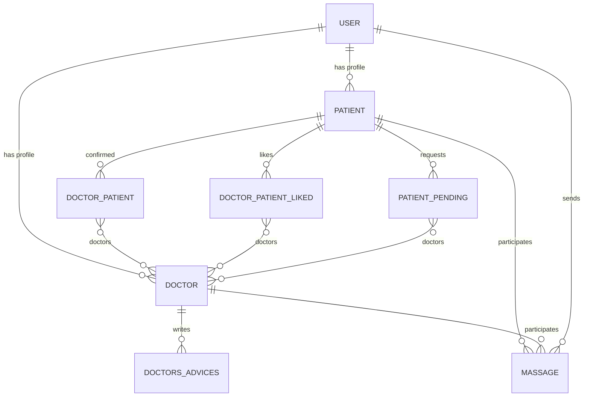

<div align="center">

# 🩺 HQmedic

**A role-based web platform that connects patients with doctors — find specialists, build a trusted care circle, message privately, and read professional medical advice.**


[▶ Watch the demo](https://youtu.be/JLnQNy-zmX0) · [Features](#-features) · [Getting Started](#-getting-started) · [Architecture](#-architecture)

[](https://youtu.be/JLnQNy-zmX0)

</div>

---

## 📑 Table of Contents

- [Overview](#-overview)
- [Demo](#-demo)
- [Features](#-features)
- [Distinctiveness and Complexity](#-distinctiveness-and-complexity)
- [Tech Stack](#-tech-stack)
- [Getting Started](#-getting-started)
- [Usage Walkthrough](#-usage-walkthrough)
- [Architecture](#-architecture)
  - [Data Model](#data-model)
  - [Routes & API Endpoints](#routes--api-endpoints)
  - [Project Structure](#project-structure)
- [Design Decisions](#-design-decisions)
- [Roadmap](#-roadmap)
- [Author](#-author)

---

## 🔎 Overview

Finding the right doctor and getting reliable medical guidance is harder than it should be. **HQmedic** simplifies this by giving two kinds of users a shared, structured space:

- **Patients** browse doctors grouped by specialty, rank them through likes, send consultation requests, and — once a doctor accepts — communicate with them privately.
- **Doctors** publish medical advice for the community, review incoming patient requests, and manage their patient list.

A single email can hold **both a patient and a doctor profile**, so a physician can also use the platform as a patient with the same account.

> Built with Django (Python) on the backend and vanilla JavaScript, HTML, and CSS on the frontend, with a responsive layout for desktop and mobile.

## 🎬 Demo

A full walkthrough of the application is available on YouTube:

**👉 [https://youtu.be/JLnQNy-zmX0](https://youtu.be/JLnQNy-zmX0)**

## ✨ Features

### 👤 For Patients

| Feature | Description |
|---|---|
| **Doctor directory** | Doctors are grouped by specialty, with a counter of how many doctors each specialty has, and sorted by popularity (likes). |
| **Like / Unlike** | Toggle a like on any doctor; the counter updates instantly without a page reload. |
| **Add a doctor** | Send a consultation request. The request stays on the **Pending** page until the doctor confirms it. |
| **My Doctors** | View confirmed doctors, loaded dynamically in the menu without leaving the page. |
| **Private messaging** | Exchange titled messages with confirmed doctors, visible only to the two parties. |
| **Advice feed** | Read medical advice posted by doctors across all specialties. |
| **Profile** | Manage a profile photo and view personal details (name, email, phone, gender). |

### 🩺 For Doctors

| Feature | Description |
|---|---|
| **Post medical advice** | Publish advice from the Advices page; posts are submitted asynchronously. |
| **Pending requests** | Review patient requests and **Confirm** or **Delete** each one. |
| **Patient list** | See all confirmed patients on the home page and remove a patient when needed. |
| **Private messaging** | Reply to and message confirmed patients from their profile page. |
| **Public profile** | Showcase specialty, contact details, and every piece of advice you have written. |

### 🔐 Accounts & Security

- Custom `User` model with **email-based authentication** (custom authentication backend).
- Separate **patient** and **doctor** login/registration flows, with a category selector on the entry page.
- **Dual-role accounts**: registering as a doctor with an existing patient account (or vice versa) simply adds the second profile.
- Session-based role switching (`patient` / `doctor`) and page-level access protection with `@login_required`.
- Custom `@logedin` decorator that redirects already-authenticated users away from the login page.
- Client-side form validation feedback and server-side error messages.

## 🧠 Distinctiveness and Complexity

HQmedic is distinct from a social network or e-commerce project: it models a **two-sided, permission-gated relationship** between two different kinds of users.

1. **Request → approval workflow.** A patient does not simply "follow" a doctor. They send a request that sits in a pending state until the doctor accepts or rejects it. Only an accepted relationship unlocks private messaging.
2. **One identity, two roles.** A single account can act as both patient and doctor. Authentication, registration, session state, and the UI all adapt to the role the user logged in as.
3. **Relational data model.** Many-to-many relationships track confirmed doctors, pending requests, and liked doctors, alongside advices and messages — each tied to the correct role profile.
4. **Asynchronous, JSON-driven frontend.** Likes, add/remove requests, "My Doctors", and advice posting run through `fetch` calls to JSON endpoints. The "My Doctors" view is rendered entirely client-side from serialized Django objects.
5. **Responsive interface.** The layout adapts across breakpoints for desktop and mobile using CSS Grid and Flexbox.

## 🛠 Tech Stack

| Layer | Technology |
|---|---|
| **Backend** | Python 3.10+, Django 5.1 |
| **Database** | SQLite (Django ORM) |
| **Authentication** | Django auth with a custom user model and custom email backend |
| **Frontend** | HTML5, CSS3 (Grid / Flexbox, media queries), vanilla JavaScript (ES6, Fetch API) |
| **Media handling** | Django `ImageField` (Pillow) for profile photos |

## 🚀 Getting Started

### Prerequisites

- Python 3.10 or newer
- `pip`

### Installation

```bash
# 1. Clone the repository
git clone <your-repository-url>
cd HQmedic

# 2. (Recommended) Create and activate a virtual environment
python -m venv venv
source venv/bin/activate        # macOS / Linux
venv\Scripts\activate           # Windows

# 3. Install dependencies
pip install django pillow

# 4. Apply database migrations
python manage.py makemigrations first_app
python manage.py migrate

# 5. (Optional) Create an admin account
python manage.py createsuperuser

# 6. Start the development server
python manage.py runserver
```

Open **http://127.0.0.1:8000/** in your browser.

## 🧭 Usage Walkthrough

1. **Choose a category** on the entry page — *Doctor* or *Patient* — then log in or register.
2. **As a patient:** browse doctors on the home page, like your favourites, press **Add** to send a request, and track it under **Menu → Pending**.
3. **As a doctor:** open **Menu → Pending** to confirm or delete incoming requests. Confirmed patients appear on your home page.
4. **Message each other** from the other person's profile once the connection is confirmed.
5. **Doctors share advice** from **Menu → Advices**; everyone can read the feed.
6. **Update your photo** from your **Profile** page.

## 🏗 Architecture

### Data Model



| Model | Purpose |
|---|---|
| `User` | Custom user (email login) with role flags (`is_patient`, `is_doctor`), phone, gender, age, and profile photo. |
| `patient` / `doctor` | Role profiles linked to a `User`. `doctor` also stores `specialist` and a `likes` counter. |
| `doctor_patient` | Confirmed doctor ↔ patient relationships. |
| `patient_pending` | Consultation requests awaiting doctor approval. |
| `doctor_patient_liked` | Doctors a patient has liked (powers the like/unlike toggle). |
| `doctors_advices` | Medical advice authored by doctors, with an automatic date. |
| `massage` | Private messages (title, body, date, sender) between a patient and a doctor. |

### Routes & API Endpoints

**Pages**

| Route | View | Description |
|---|---|---|
| `/` | `index` | Doctor directory (patients) or patient list (doctors) |
| `/login` | `login_view` | Entry page with category selection |
| `/login_patient`, `/login_doctor` | `login_patient`, `login_doctor` | Role-specific login |
| `/patient_register`, `/doctor_register` | `patient_register`, `doctor_register` | Role-specific registration |
| `/logout` | `logout_view` | End the session |
| `/profile/<status>/<id>` | `profile` | Patient or doctor profile, advices, and messages |
| `/advices` | `advices` | Advice feed (and composer for doctors) |
| `/pending` | `pending` | Pending requests (role-aware) |
| `/confirm` | `confirm` | Doctor confirms or deletes a patient request |
| `/remove` | `remove` | Doctor removes a patient |
| `/massage` | `massaging` | Send a private message |
| `/add_photo/<status>` | `add_photo` | Upload a profile photo |

**JSON endpoints (called via `fetch`)**

| Route | Method | Purpose |
|---|---|---|
| `/liked` | `POST` | Check whether the current patient liked a doctor |
| `/like` | `POST` | Like or unlike a doctor |
| `/added` | `POST` | Check whether a doctor is added or pending |
| `/add` | `POST` | Add (request) or remove a doctor |
| `/my_doctors` | `POST` | Return confirmed doctors grouped by specialty |
| `/add_advice` | `POST` | Publish a new piece of advice |

### Project Structure

```
HQmedic/
├── manage.py
├── db.sqlite3
├── HQmedic/                    # Project configuration
│   ├── settings.py
│   ├── urls.py
│   ├── asgi.py
│   └── wsgi.py
└── first_app/                  # Main application
    ├── models.py               # Users, doctors, patients, advices, messages
    ├── views.py                # Page views, forms, and JSON endpoints
    ├── urls.py                 # App URL routing (+ media serving)
    ├── backends.py             # Email-based authentication backend
    ├── decorators.py           # @logedin decorator
    ├── admin.py
    ├── apps.py
    ├── tests.py
    ├── migrations/
    ├── profile_images/         # Uploaded profile photos (+ default.png)
    ├── static/first_app/
    │   ├── style.css           # Responsive styling
    │   ├── Script.js           # Login / registration UI logic
    │   └── Script2.js          # Doctors, likes, requests, advices (Fetch API)
    └── templates/first_app/
        ├── layout.html         # Shared navbar and menu
        ├── login.html          # Role selection, login, and registration
        ├── index.html          # Doctor directory / patient list
        ├── profile.html        # Profile, advices, and messaging
        ├── advices.html        # Advice feed and composer
        └── pending.html        # Pending requests
```

## 🎯 Design Decisions

- **Email as the login identifier** via a custom backend, which is what makes dual-role accounts possible with a single credential set.
- **Session-stored role** (`request.session["status"]`) so the same account can switch between patient and doctor experiences by logging in through the corresponding form.
- **Hybrid rendering**: server-rendered Django templates for pages, with `fetch`-based JSON endpoints for interactions that should not reload the page.
- **Confirmation gate for messaging**: the messaging panel only appears on a profile when a confirmed doctor–patient relationship exists.

## 🗺 Roadmap

- [ ] Replace `@csrf_exempt` JSON endpoints with CSRF-token-protected requests
- [ ] Add automated tests for authentication, request approval, and messaging flows
- [ ] Real-time messaging and notifications (WebSockets / Django Channels)
- [ ] Appointment scheduling and doctor availability
- [ ] Search and filtering by name, specialty, and rating
- [ ] Email verification and password reset
- [ ] Production hardening: load `SECRET_KEY` from environment variables, set `DEBUG = False`, restrict `ALLOWED_HOSTS`
- [ ] Deployment configuration (PostgreSQL, static/media storage)

## 👨‍💻 Author

**Omar Gamal** — Biomedical Engineering student at Cairo University, focused on Data and AI Engineering.

---

<div align="center">

*HQmedic is an educational project and does not replace professional medical consultation.*

</div>
